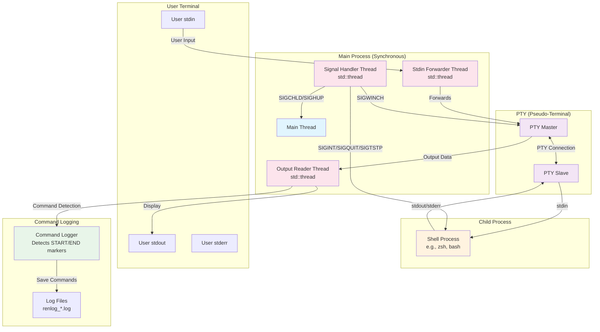
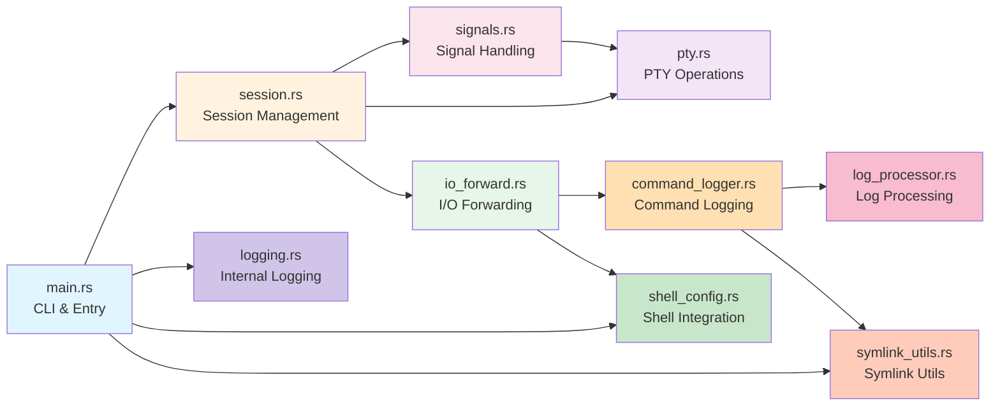

# Architecture

## Overview

renlog is a Rust-based command logging tool that captures shell session output on a per-command basis. It uses PTY (pseudo-terminal) to intercept shell I/O and detects command boundaries through shell integration hooks.

## Process Architecture

## Module Structure

## Module Descriptions

### main.rs
**Entry point and CLI handling**
- Parses command-line arguments using `clap`
- Supports `log`, `show-bash-rc`, and `show-zsh-rc` subcommands
- Initializes logging infrastructure
- Creates renlog directory structure with PID-based subdirectories
- Creates and manages `renlog-latest.log` symlink
- Invokes `run_pty_session()` to start the session

### session.rs
**PTY session lifecycle management**
- Creates and manages PTY pairs
- Spawns child shell process with proper stdio redirection
- Sets up `pre_exec` hook for:
  - Creating new session with `setsid()`
  - Setting controlling terminal with `TIOCSCTTY`
  - Closing slave FD to prevent leakage
  - Setting `FD_CLOEXEC` on high-numbered FDs
- Starts I/O forwarder threads (stdin→pty, pty→stdout)
- Manages session shutdown via flags and mutexes
- Provides callbacks for signal handler integration
- Validates and duplicates file descriptors for thread safety
- Restores terminal settings on drop

### pty.rs
**Low-level PTY operations**
- Creates PTY master/slave pairs using `nix::pty::openpty`
- Gets/sets terminal window size (Winsize)
- Propagates terminal resize events from stdin to PTY master
- Implements raw mode setup for terminal I/O:
  - Disables canonical mode, echo, and signal processing
  - Sets immediate character reading (VMIN=1, VTIME=0)
- Saves and restores original terminal attributes (Termios)
- Validates FD readiness using `fcntl` and `poll`

### signals.rs
**Comprehensive signal handling**
- Creates signal handler thread using `signal-hook`
- Handles multiple signals:
  - **SIGWINCH**: Propagates terminal resize to PTY and child session/process group
  - **SIGCHLD**: Detects child process termination and sets exit status
  - **SIGHUP**: Initiates graceful shutdown
  - **SIGINT/SIGQUIT/SIGTSTP**: Forwards to child session and process group (renlog continues running)
- Implements session-wide and process group-wide signal forwarding:
  - Reads `/proc/<pid>/stat` to find session ID and process group ID
  - Sends signals to all processes in the session and process group
  - Falls back to process group kill (`kill(-pid)`) if individual sends fail
- Uses Arc<Mutex<>> for thread-safe communication with main session
- Supports graceful shutdown via shutdown flag

### io_forward.rs
**I/O data forwarding and command detection**
- `forward_stdin_to_pty()`: Simple passthrough from stdin to PTY master
  - 32KB buffer for efficient I/O
  - Handles EINTR (interrupted system calls)
  - Tracks total bytes forwarded
- `forward_pty_to_stdout_with_logging()`: Complex output processing
  - Writes PTY output to stdout immediately (real-time display)
  - Buffers data for marker detection
  - Detects `renlog-start-command <cmd>` markers to begin command logging
  - Detects `renlog-end-command <exit_status>` markers to save logs
  - Implements skip list for sensitive commands (nvim, pass)
  - Maintains 1KB sliding window for marker detection
  - Invokes command logger to save per-command output

### command_logger.rs
**Per-command log file management**
- `save_command_log()`: Main entry point for saving command logs
  - Sanitizes command strings for safe filenames (replaces `/\:*?"<>|\n\r\t` with `_`, spaces with `-`)
  - Truncates long filenames to 256 characters while preserving extensions
  - Generates timestamped filenames: `<timestamp>_<command>.log`
  - Writes metadata header (command, timestamp, exit status)
  - Processes log content (removes ANSI codes, command markers)
  - Creates `latest.log` symlink pointing to most recent log
  - Updates `renlog_current_log` tracking file for shell integration
  - Applies optional log filter command (e.g., grep, sed) after saving
- `apply_log_filter()`: Executes user-specified filter command
  - Creates temporary file for filtered output
  - Runs shell command pipeline: `cat log | filter_cmd > temp`
  - Atomically replaces original log with filtered version
  - Cleans up temporary files on error

### log_processor.rs
**Log content cleaning and normalization**
- `process_command_log_content()`: Main processing pipeline
  - Truncates output after first `renlog-end-command` marker
  - Strips ANSI escape codes (colors, cursor movement, etc.)
  - Removes command markers (`renlog-start-command`, `renlog-end-command`)
  - Normalizes line endings (CRLF → LF)
- Uses compiled regex patterns cached in `OnceLock` for performance
- Comprehensive ANSI escape sequence support:
  - CSI sequences (Control Sequence Introducer): `ESC[...`
  - OSC sequences (Operating System Command): `ESC]...`
  - DCS, SOS, PM, APC sequences
  - Single-character escape sequences
  - Special control characters (backspace, shift in/out)

### shell_config.rs
**Shell integration script generation**
- Defines command markers: `renlog-start-command`, `renlog-end-command`
- Defines tracking file constant: `renlog_current_log`
- `show_bash_rc()`: Generates Bash integration script
  - Uses DEBUG trap for preexec functionality
  - Uses PROMPT_COMMAND for postexec functionality
  - Sends command marker before execution
  - Sends end marker with exit status after execution
  - Uses advanced terminal control sequences to hide markers:
    - `\r\e[K`: Carriage return + clear line
    - `\e[1A\e[2K`: Move up + clear line (fallback)
  - Displays current log file path after command completion
- `show_zsh_rc()`: Generates Zsh integration script
  - Uses `preexec_functions` array for preexec hook
  - Uses `precmd_functions` array for postexec hook
  - Disables `prompt_cr` and `prompt_sp` to prevent spurious output
  - Similar terminal control and log file display as Bash version

### logging.rs
**Internal renlog logging infrastructure**
- Implements custom logger (`GlogLogger`) following Google's glog format
- Log format: `<LEVEL><TIMESTAMP> <PID> <FILE:LINE>] <MESSAGE>`
  - Example: `I20250123 12:34:56.789012 12345 main.rs:42] Starting renlog...`
- Thread-safe file-based logging using `Mutex<Option<File>>`
- Configurable log levels (error/warn/info/debug/trace)
- Falls back to null logging if file initialization fails
- Sets file permissions to 0o600 (owner read/write only)
- Atomic flag (`LOGGING_ENABLED`) to track initialization state

### symlink_utils.rs
**Symlink creation utilities**
- `create_or_update_symlink()`: Atomic symlink management
  - Removes existing symlink if present
  - Creates new symlink pointing to target
  - Used for `renlog-latest.log` and `latest.log` symlinks
  - Provides centralized error handling and logging

## Data Flow Description

### 1. User Input Path
User input from stdin is forwarded by a dedicated std::thread to the PTY master, which passes it to the PTY slave connected to the shell process.

### 2. Shell Output Path
The shell's stdout/stderr outputs to the PTY slave, which is read by the PTY master. A unified output reader thread (std::thread) then:
- Displays the output to the user's stdout immediately
- Detects command boundaries using special markers embedded by shell hooks
- Buffers command output between START and END markers
- Logs command output to separate timestamped files

### 3. Signal Handling
A dedicated std::thread using signal-hook handles signals synchronously:
- **SIGWINCH**: Terminal window resize events
  - Propagated to PTY master via `ioctl(TIOCSWINSZ)`
  - Forwarded to all processes in child session and process group
- **SIGCHLD**: Child process termination
  - Sets exit status in shared state
  - Triggers shutdown flag to stop main session loop
- **SIGHUP**: Session hangup
  - Initiates graceful shutdown of renlog
- **SIGINT/SIGQUIT/SIGTSTP**: User interrupt signals (Ctrl+C, Ctrl+\, Ctrl+Z)
  - Forwarded to child session and process group
  - Enables proper handling by interactive applications (vim, top, htop, etc.)
  - renlog continues running after forwarding these signals

### 4. Signal Forwarding Strategy
When users press Ctrl+C or send termination signals:
- Signal handler reads `/proc/<pid>/stat` to find session ID and process group ID
- Collects all PIDs in the same session and process group
- Sends signal to each process individually using `kill(pid, signal)`
- Falls back to process group signal `kill(-pgid, signal)` if individual sends fail
- This ensures signals reach all descendant processes (e.g., shell and its children)

### 5. Command Logging Flow
1. Shell preexec hook emits: `renlog-start-command <command_line>`
2. Output reader detects marker and starts buffering command output
3. Command executes and produces output
4. Shell postexec hook emits: `renlog-end-command <exit_status>`
5. Output reader detects end marker and saves buffered output:
   - Creates timestamped log file
   - Writes metadata header
   - Processes content (removes ANSI codes, markers)
   - Applies optional user filter command
   - Updates `latest.log` symlink
   - Updates `renlog_current_log` tracking file
6. Shell displays log file path to user

### 6. Session Lifecycle
1. **Initialization** (`main.rs`):
   - Parse CLI arguments
   - Create renlog directory structure
   - Initialize internal logging
2. **PTY Setup** (`session.rs`, `pty.rs`):
   - Create PTY master/slave pair
   - Set raw mode on stdin
   - Save original terminal settings
3. **Child Process Creation** (`session.rs`):
   - Spawn shell with PTY slave as stdio
   - Set environment variables (`RENLOG_PID`, `RENLOG_LAST_LOG_FILE`)
   - Create new session and set controlling terminal
4. **I/O Forwarding** (`io_forward.rs`):
   - Start stdin→pty forwarder thread
   - Start pty→stdout forwarder thread with command detection
5. **Signal Handling** (`signals.rs`):
   - Start signal handler thread
   - Register handlers for all supported signals
6. **Session Monitoring** (`session.rs`):
   - Main thread waits on shutdown flag
   - Signal handler sets flag when child exits
7. **Cleanup** (`session.rs` Drop):
   - Restore original terminal settings
   - Kill child process if still running
   - Close PTY file descriptors

## Key Design Decisions

### Thread-Based Concurrency
- Uses standard library threads (`std::thread`) for simplicity
- Avoids async complexity for straightforward I/O forwarding
- Signal handler runs in dedicated thread using `signal-hook`

### File Descriptor Management
- Duplicates FDs before passing to threads to prevent premature closure
- Validates FDs using `fcntl(F_GETFD)` before use
- Sets `FD_CLOEXEC` on high-numbered FDs to prevent leakage

### Command Boundary Detection
- Shell integration hooks emit plain-text markers
- Markers hidden from user using terminal control sequences
- Sliding window buffer (1KB) for efficient marker detection

### Signal Forwarding Strategy
- Forwards signals to entire session and process group
- Reads `/proc` filesystem to discover all related processes
- Enables proper handling of complex process trees (e.g., tmux, screen)

### Log File Naming
- Sanitizes command strings to prevent filesystem issues
- Truncates long filenames while preserving extensions
- Uses high-precision timestamps (milliseconds) to avoid collisions

### Terminal Raw Mode
- Sets raw mode on stdin for proper character-by-character forwarding
- Preserves and restores original terminal settings
- Handles non-TTY stdin gracefully (e.g., piped input)
