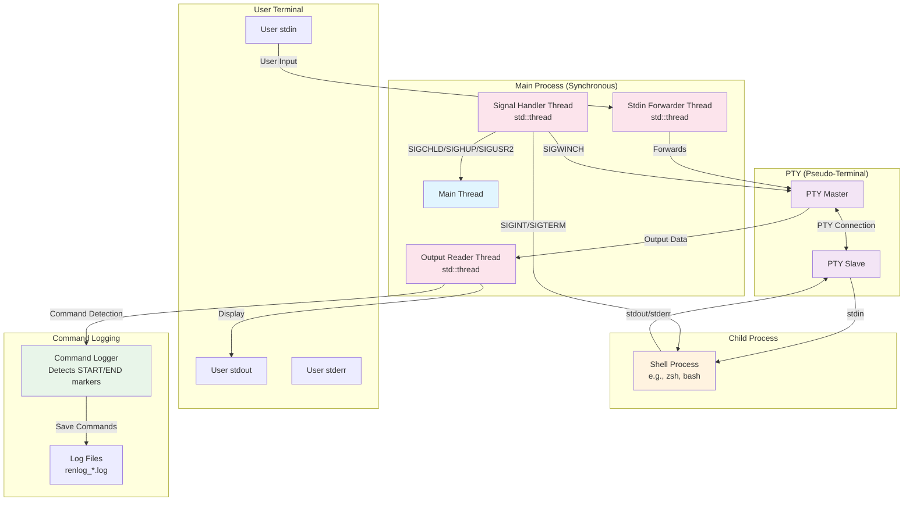
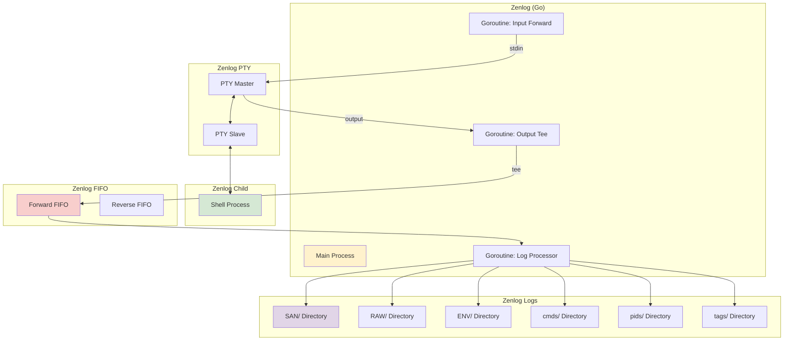
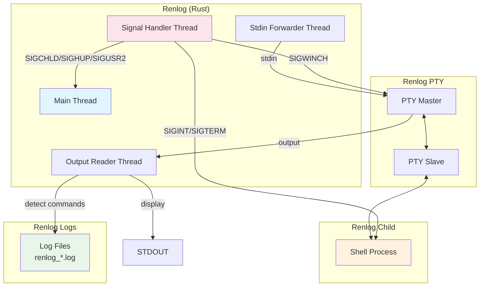

# Renlog - Rust Implementation of Zenlog

Renlog is a Rust re-implementation of [zenlog](https://github.com/omakoto/zenlog).

## Architecture

### Data Flow Description

1. **User Input Path**: User input from stdin is forwarded by a dedicated std::thread to the PTY master, which passes it to the PTY slave connected to the shell process.

2. **Shell Output Path**: The shell's stdout/stderr outputs to the PTY slave, which is read by the PTY master. A unified output reader thread (std::thread) then:
   - Displays the output to the user's stdout
   - Detects command boundaries using special markers
   - Logs command output to separate files

3. **Signal Handling**: A dedicated std::thread using signal-hook handles signals synchronously:
   - SIGWINCH for terminal window resize events (forwarded to PTY master)
   - SIGCHLD for child process termination (handled by main process)
   - SIGHUP for session hangup (handled by main process)
   - SIGUSR2 for debug information (handled by main process)
   - SIGINT/SIGTERM for interrupt/termination (forwarded to child process)

4. **Signal Forwarding**: When users press Ctrl+C or send termination signals, the signal handler forwards SIGINT/SIGTERM to the child process, enabling proper termination of interactive applications like `top`, `htop`, `vim`, etc.

5. **Command Logging**: The output reader detects START_COMMAND and END_COMMAND markers in the stream, buffering and saving each command's output to individual log files.

## Zenlog vs Renlog Comparison

Renlog is a Rust reimplementation of [zenlog](https://github.com/omakoto/zenlog), designed to be simpler, more focused, and easier to understand while maintaining the core functionality of automatic command logging.

### Architecture Comparison

#### Zenlog (Go Implementation)

#### Renlog (Rust Implementation)

### Feature Comparison

| Feature | Zenlog (Go) | Renlog (Rust) |
|---------|-------------|---------------|
| **Language** | Go | Rust |
| **Concurrency Model** | Goroutines | std::thread |
| **PTY Management** | creack/pty library | nix crate |
| **Signal Handling** | Basic | Enhanced (SIGINT/SIGTERM forwarding) |
| **FIFO Pipes** | ✅ Used for communication | ❌ Removed (unused) |
| **Log Structure** | Complex (SAN/RAW/ENV/cmds/pids/tags) | Simple (individual command logs) |
| **Command Detection** | Shell hooks + markers | START/END markers |
| **Interactive Apps** | Limited Ctrl+C support | ✅ Full Ctrl+C support |
| **Memory Safety** | Garbage collected | Zero-cost abstractions |
| **Binary Size** | Larger (Go runtime) | Smaller (static linking) |
| **Startup Time** | Slower (GC initialization) | Faster (compiled binary) |
| **Dependencies** | Many Go modules | Minimal Rust crates |
| **Configuration** | TOML file | Command line flags |
| **Log Organization** | Per-command/PID/tag directories | Flat structure with timestamps |
| **Shell Integration** | Complex setup scripts | Simple configuration |

### Key Differences

#### **Simplicity vs Features**
- **Zenlog** provides a comprehensive logging ecosystem with complex directory structures, tagging, and multiple output formats
- **Renlog** focuses on core functionality with a simpler, more maintainable design

#### **Performance**
- **Zenlog** uses Go's garbage collector and goroutines, which can introduce latency
- **Renlog** uses Rust's zero-cost abstractions and manual memory management for predictable performance

#### **Signal Handling**
- **Zenlog** has basic signal handling that may not work well with interactive applications
- **Renlog** implements comprehensive signal forwarding, making Ctrl+C work properly with `top`, `htop`, `vim`, etc.

#### **Architecture Philosophy**
- **Zenlog** uses FIFO pipes and complex async communication patterns
- **Renlog** uses a simpler thread-based approach with direct PTY communication

#### **When to Choose What**

**Choose Zenlog if you need**:
- Complex log organization with per-command/PID/tag directories
- Advanced shell integration features
- Mature ecosystem with extensive tooling

**Choose Renlog if you want**:
- Simpler, more maintainable codebase
- Better performance and lower resource usage
- Proper signal handling for interactive applications
- Modern Rust safety guarantees
- Easier debugging and modification
