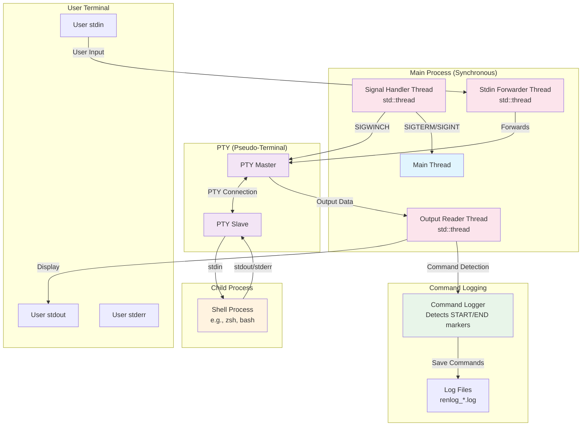

# Renlog - Rust Implementation of Zenlog

Renlog is a Rust re-implementation of [zenlog](https://github.com/omakoto/zenlog).

## Architecture

### Data Flow Description

1. **User Input Path**: User input from stdin is forwarded by a dedicated std::thread to the PTY master, which passes it to the PTY slave connected to the shell process.

2. **Shell Output Path**: The shell's stdout/stderr outputs to the PTY slave, which is read by the PTY master. A unified output reader thread (std::thread) then:
   - Displays the output to the user's stdout
   - Detects command boundaries using special markers
   - Logs command output to separate files

3. **Signal Handling**: A dedicated std::thread using signal-hook handles signals synchronously:
   - SIGWINCH for terminal window resize events
   - SIGCHLD for child process termination
   - SIGHUP for session hangup
   - SIGUSR2 for debug information

4. **Command Logging**: The output reader detects START_COMMAND and END_COMMAND markers in the stream, buffering and saving each command's output to individual log files.
